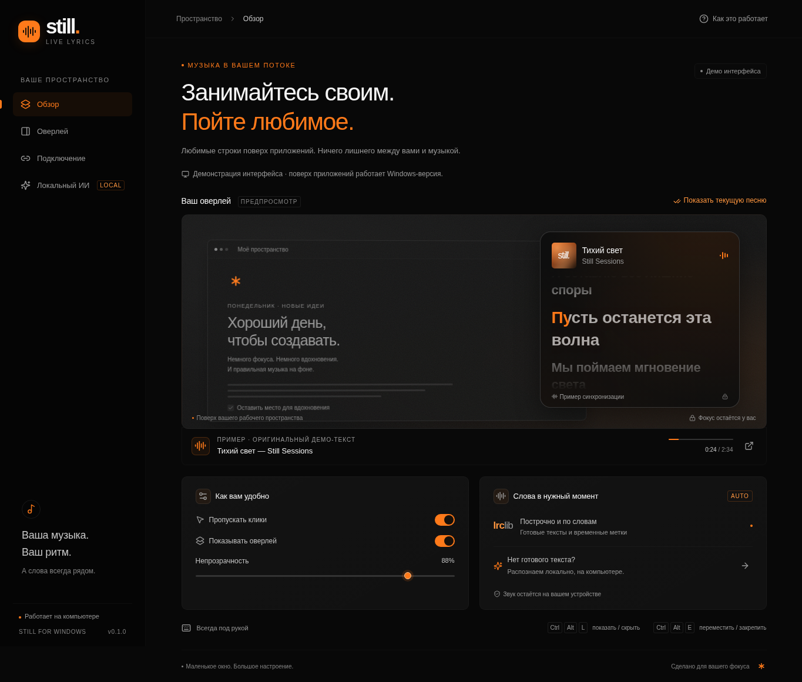
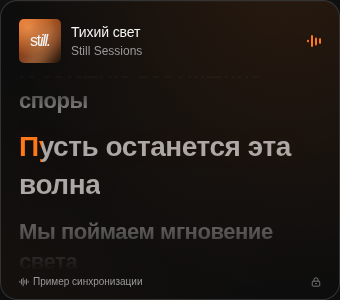
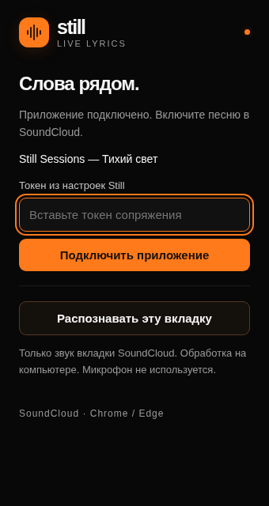

<div align="center">

# still. — Live Lyrics

**Ваша музыка. Ваш ритм. Слова всегда рядом.**

Маленький оверлей поверх рабочих приложений. Большое настроение.


[Скачать для Windows](https://github.com/insultikkk/Portfolio/releases/tag/v0.1.0) · [Как установить](docs/windows-install.md) · [Статус сборки](https://github.com/insultikkk/Portfolio/actions/workflows/windows.yml)

</div>



> Скриншоты настоящего интерфейса с оригинальным демонстрационным текстом. Они не изображают подключённый SoundCloud и не подтверждают проверку окон на Windows.

Небольшой оверлей для Windows 10/11: SoundCloud играет в Chrome/Edge, текст остаётся поверх рабочих приложений. Матовая карточка, построчные/пословные тайминги, LRCLIB, локальное распознавание Whisper и кэш SQLite. Spotify и Яндекс Музыка пока не подключены.

Дизайн — чёрный и графитовый фон, белый текст и оранжевый акцент `#FF7A1A`. Активная строка и спетые слова подсвечиваются оранжевым, соседние строки остаются приглушённо-белыми. Оверлей, настройки и popup расширения используют одну палитру; оттенок обложки добавляется только мягким фоновым свечением.

Крупный текст по умолчанию: активная строка — 28 px, соседние — 22 px, обычный текст без таймингов — 20 px. В разделе **Оверлей → Размер текста** масштаб можно изменить от 75% до 150% (активная строка — до 42 px). При изменении размера шрифта и окна текущая строка снова центрируется.

## Скачать на другой ПК

1. Откройте [версию 0.1.0](https://github.com/insultikkk/Portfolio/releases/tag/v0.1.0) и раздел **Assets**.
2. Скачайте **`Still-v0.1.0-Windows-x64.zip`** — внутри установщик, папка `extension` для Chrome/Edge и инструкция.
3. Распакуйте архив, установите Still и загрузите папку `extension` через «Загрузить распакованное расширение» в браузере.
4. Сопрягите приложение и расширение токеном из настроек Still. Включите песню в SoundCloud.

Для готового архива не нужны Rust, Node.js и инструменты разработчика. Нужны Windows 10/11 x64 и Chrome/Edge 116+. Подробно — [установка и первый запуск](docs/windows-install.md).

**Первая версия — предварительная и без цифровой подписи.** Windows может показать предупреждение SmartScreen. Проверяйте источник и SHA-256 из релиза; не отключайте защиту системы. Работа поверх окон и реальный захват вкладки требуют ручной проверки на Windows.

Если релиз ещё собирается, его архив появится только после успешного [workflow Windows build](https://github.com/insultikkk/Portfolio/actions/workflows/windows.yml). Кнопка GitHub **Code → Download ZIP** скачивает исходники, а не установленное приложение.

## Как выглядит

<table>
  <tr>
    <td align="center"><strong>Оверлей · 340 × 300</strong></td>
    <td align="center"><strong>Расширение Chrome / Edge</strong></td>
  </tr>
  <tr>
    <td align="center" valign="top"></td>
    <td align="center" valign="top"></td>
  </tr>
</table>

## Что внутри

- Карточка поверх обычных приложений, вне Alt+Tab, с пропуском кликов.
- Построчная и, когда источник их предоставляет, пословная синхронизация.
- LRCLIB для готовых текстов; SQLite-кэш для повторного прослушивания без сети.
- Локальный Whisper для редких треков: без API-ключей, микрофона и передачи аудио в облачный ASR.
- Настройка прозрачности, размера, положения и ручной поправки тайминга.
- Чёрный, белый и оранжевый — один стиль для приложения, трея и расширения.

## Сборка из исходников на Windows

Нужны Node.js 24 LTS, Rust stable (MSVC), Visual Studio Build Tools 2022 с **Desktop development with C++** и CMake, LLVM с libclang, Windows SDK и WebView2 Runtime. Для клонирования исходников квантователя нужен Git. Python для приложения не требуется.

```powershell
npm ci
$env:LIBCLANG_PATH = 'C:\Program Files\LLVM\bin'
powershell -ExecutionPolicy Bypass -File scripts/prepare-windows.ps1
npm run desktop:dev
```

Скрипт собирает квантователь из зафиксированного commit whisper.cpp v1.7.6 и отдельный процесс `lyrics-whisper`. Их исходники проверяются Git; скачивание модели сохраняет проверку TLS. Первая сборка требует Интернета и занимает время.

Личный установщик:

```powershell
npm run desktop:build
npm run extension:build
```

Установщик появится в `src-tauri/target/release/bundle/nsis`, расширение — в `dist/extension`. Выполняйте сборку расширения **после** frontend-сборки: Vite очищает `dist`. Рабочие процессы не переживают перезапуск — приложение запускается заново из меню Windows.

Альтернатива: открыть **Actions → Windows build → Run workflow**, оставить ветку `main` и тег `v0.1.0`, нажать зелёную **Run workflow**. Сборка берёт исходники именно выбранного тега, сохраняет artifact `Still-Windows-x64` и публикует предварительный GitHub Release с установщиком, расширением и SHA-256. Новый тег версии также запускает сборку автоматически, если GitHub разрешает событие от используемого подключения. Сайт, музыкальные аккаунты и приватные данные workflow не публикует; видимость репозитория не меняет.

## Подключение SoundCloud

1. Chrome: `chrome://extensions`, Edge: `edge://extensions`. Включить режим разработчика и выбрать **Загрузить распакованное расширение** → `dist/extension`.
2. В Still открыть **Подключение**, скопировать токен и вставить его в popup расширения.
3. Обновить вкладку SoundCloud после установки расширения и включить песню. Если исполнитель неизвестен или есть несколько версий, выбрать результат в Still.

Не нужны SoundCloud API key, Spotify Premium, музыкальные пароли или cookies. Расширение работает только на SoundCloud и с локальным приложением. Одновременно используется один активный трек. При распознавании выбранная вкладка закрепляется как источник.

`Ctrl+Alt+L` — показать/скрыть карточку. `Ctrl+Alt+E` — разрешить перемещение/снова пропускать клики. Закрытие настроек оставляет приложение в трее; **Выйти** в трее завершает его. При конфликте горячих клавиш используйте трей. Изменение размера и непрозрачности — в разделе **Оверлей**. Положительная поправка тайминга продвигает текст вперёд.

Карточка предназначена для обычных окон Windows; secure desktop, UAC и эксклюзивный fullscreen не являются поддерживаемыми поверхностями. Смена виртуальных рабочих столов не входит в обещание «Alt+Tab».

## Как получаем текст

`SoundCloud → расширение → локальный WebSocket → кэш / LRCLIB → движок синхронизации → оверлей`.

`PlayerAdapter` представлен снимками плеера, `LyricsProvider` — независимым интерфейсом источника текстов. Снимок содержит идентификатор записи, длительность, позицию, скорость, статус и epoch. Перемотка, пауза, реклама и смена записи разделяют аудиофрагменты.

LRCLIB вызывается из Rust, без CORS-прокси. Поддерживаются обычный текст, LRC, instrumental и Lyricsfile 1.0 с `lines[].words`, если сервер их предоставляет. Автовыбор требует совпадения исполнителя, названия, версии и длительности (±2,5 с). Имя загрузчика SoundCloud не используется как достоверное имя исполнителя. Неоднозначные результаты выбирает пользователь. Genius открывается как поиск в браузере, страницы с текстами не собираются.

## Локальный ИИ

В **Локальный ИИ** нажать **Подготовить локальную модель**. С официального репозитория Hugging Face скачивается оригинальная многоязычная Whisper Small (~466 МиБ), проверяется опубликованный автором SHA-1 `55356645c2b361a969dfd0ef2c5a50d530afd8d5`, затем модель квантуется локально в Q5_1. Для готовой локальной модели сохраняется SHA-256 и проверяется перед запуском worker. Если любая проверка не прошла, файл не используется; проверки TLS и контрольных сумм не отключаются.

После подготовки модели открыть расширение на играющей вкладке SoundCloud и нажать **Распознавать эту вкладку**. Chrome требует действия пользователя: автоматический скрытый захват не запускается. Chrome/Edge 116+ необходимы для передачи захвата в offscreen document.

Захватывается только звук вкладки. Он возвращается в AudioContext destination, чтобы песня продолжала звучать. В памяти формируются 10-секундные фрагменты с перекрытием 2 с, PCM mono 16 kHz. При паузе, перемотке, смене скорости или песни остаток отправляется с исходными таймингами, включая фрагменты короче секунды. Завершённые фрагменты могут дописать кэш предыдущей песни, но не подменяют текущий текст. Явная остановка захвата отменяет незавершённый запуск и обработку. Worker хранит модель между запросами, использует максимум четыре потока и в Windows запускается с пониженным приоритетом. Очередь ограничена тремя фрагментами. Аудио не записывается на диск и не отправляется внешнему ASR.

В первый раз распознанный текст появляется позже вокала. При повторном прослушивании используются сохранённые тайминги. ASR выдаёт приблизительный текст, а не гарантированно правильные авторские lyrics; слова не подсвечиваются с выдуманными точными метками. SQLite хранит только распознанные строки и реальные интервалы покрытия. Непрослушанные/пропущенные участки не считаются обработанными. Остановка захвата или отключение браузера прекращает приём звука.

## Разработка и проверки

Каждая cloud-задача уже изолирована; используйте существующий checkout, не создавайте дополнительный Git worktree без отдельного запроса.

```sh
npm ci
npm test
npm run test:extension
npm run build
cargo test --locked --manifest-path src-tauri/Cargo.toml --lib --tests
cargo check --locked --manifest-path src-tauri/Cargo.toml --features asr --bin lyrics-whisper
```

Для последней команды на Linux нужны CMake, C/C++ compiler и libclang. Библиотека Rust и worker проверяются на Linux без GTK/WebKit. Сам desktop-клиент собирается под Windows, а не как фиктивное Linux-окно.

`npm run dev` открывает браузерную демонстрацию настроек и оверлея. Она явно помечена **Демо интерфейса**, использует оригинальные демонстрационные строки и не выдаёт себя за подключённый SoundCloud. Нативные действия в ней не выполняются.

`npm run test:smoke` запускает временный dev-сервер, проверяет UI через Playwright и сохраняет снимки в `test-results`. При необходимости установить Chromium через `npx playwright install chromium` или указать `PLAYWRIGHT_CHROMIUM_EXECUTABLE`. Для уже запущенного сервера можно передать `STILL_TEST_URL`.

`npm run docs:screenshots` повторяет UI-проверки и обновляет три скриншота в `docs/images` для README. Это реальные снимки деморежима; Chrome-транспорт popup в тесте подменён явно.

`npm run test:media` проверяет bridge на настоящем HTML-аудио в локальной фикстуре: пауза, перемотка, смена записи и ошибка часов ≤300 мс. Runtime-транспорт в этой проверке заменён явно, это не тест живого SoundCloud. `npm run test:extension:smoke` отдельно загружает настоящий MV3 service worker в одноразовый профиль Chromium и проверяет подключение к WebSocket; этот тест требует разрешённой установки распакованных расширений и не подменяет отказ административной политики успехом.

Сборка Whisper использует переносимый CPU baseline через `scripts/portable-whisper.cmake`, без оптимизации под процессор CI. Скорость первого распознавания зависит от оборудования; отставание показывается отдельно. Сохранённые тексты не требуют повторной обработки.

Подробный ручной протокол Windows, включая работающий SoundCloud и распознавание вокала, — [docs/validation.md](docs/validation.md). Автотесты на фикстурах не заменяют эту проверку.

## Локальные данные и сеть

SQLite, pairing token и модели лежат в каталоге данных `app.still.lyrics` текущего пользователя. Токен не попадает в URL, логи, manifest или репозиторий. Локальный сервер слушает только `127.0.0.1:18765`, проверяет Origin расширения и токен, ограничивает размеры сообщений. Сброс подключения меняет токен и отключает существующего клиента.

Нужны `lrclib.net`, `soundcloud.com`, изображения `*.sndcdn.com`, а для модели — `huggingface.co` и хосты официальных redirect скачивания. Для сборки также нужны GitHub, npm и crates.io. Недоступность провайдера отличается от отсутствия текста; кэш доступен без сети. Не расширяйте сетевую политику до `*` для обхода ошибки.

Публичного сервера, телеметрии и автозапуска при входе нет. GitHub Actions публикует предварительные сборки только по тегам версий. Перед распространением другим людям потребуются отдельные проверка условий источников текстов и подготовка подписанного выпуска.
